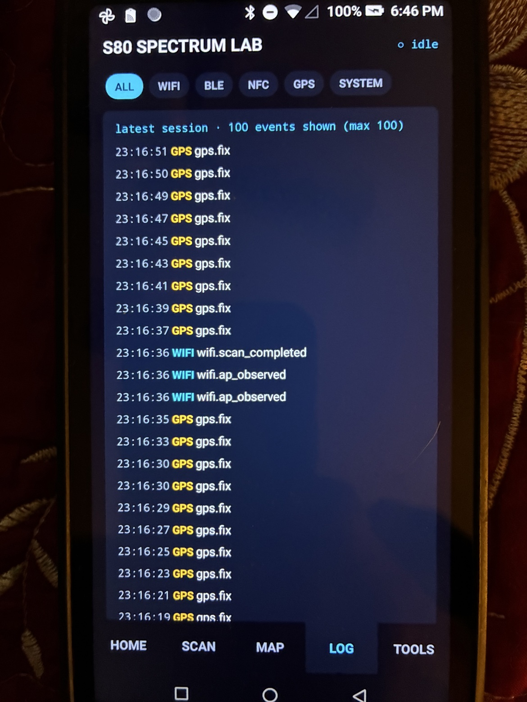
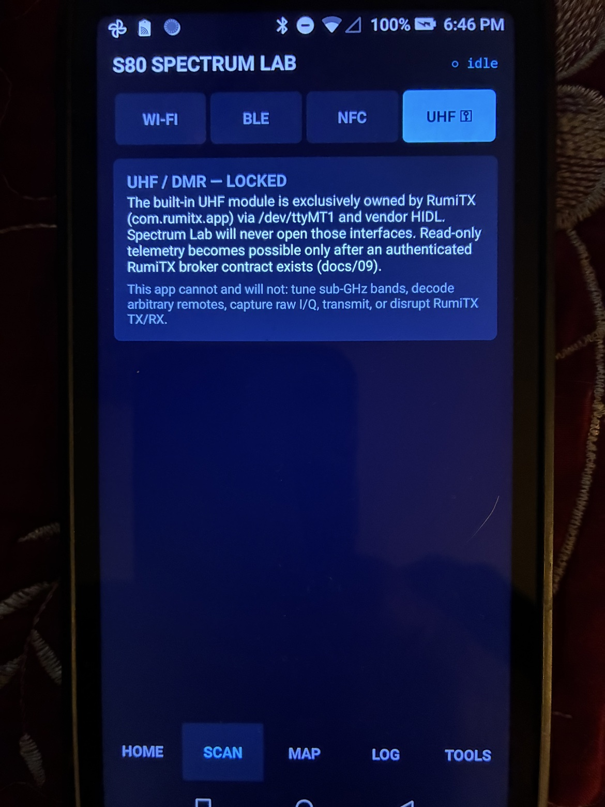
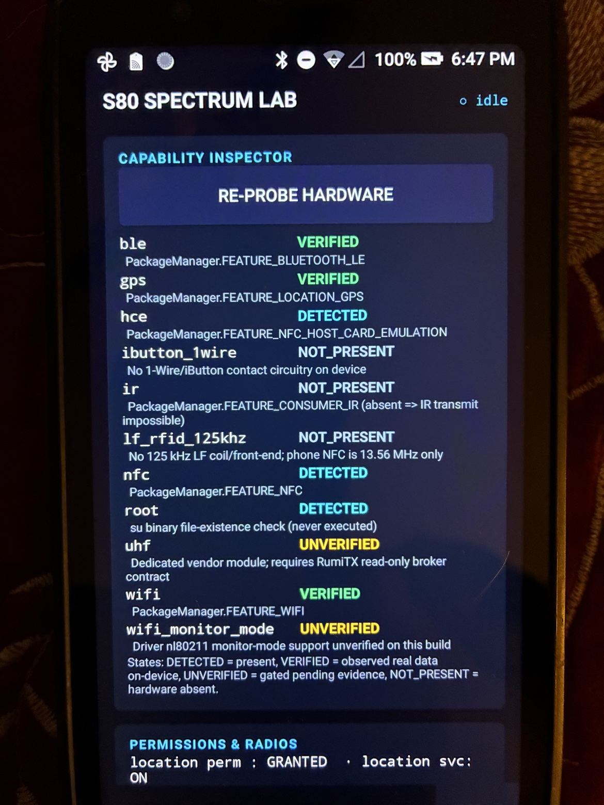
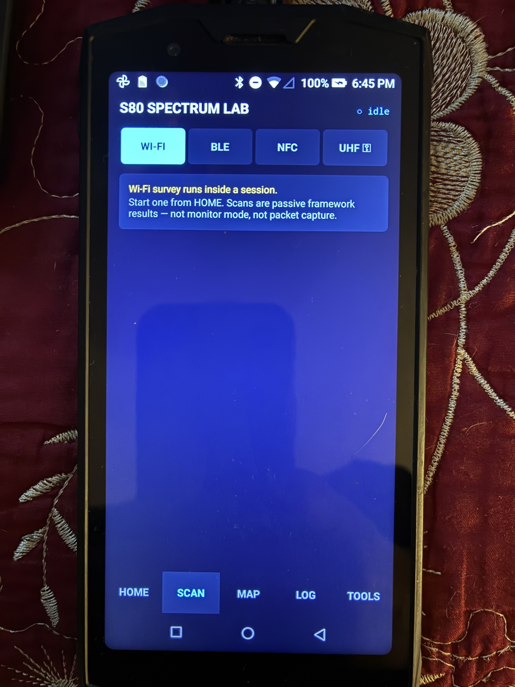
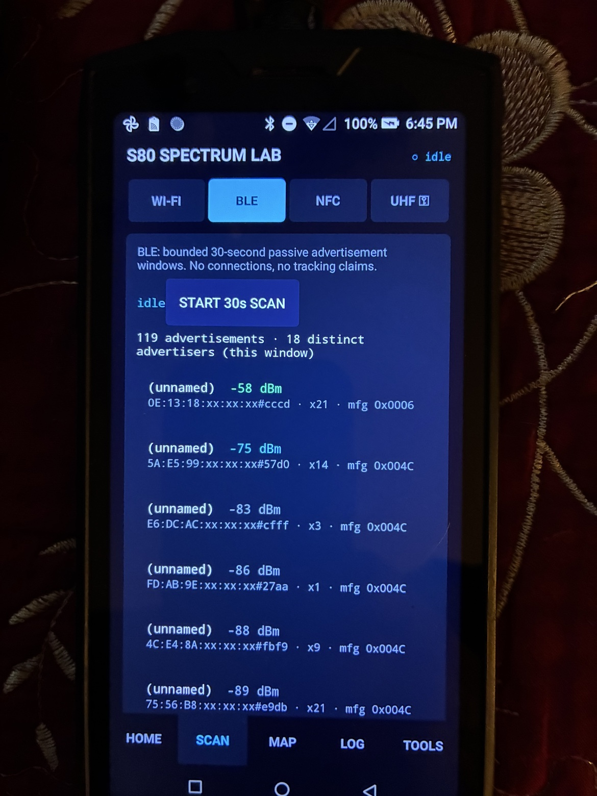
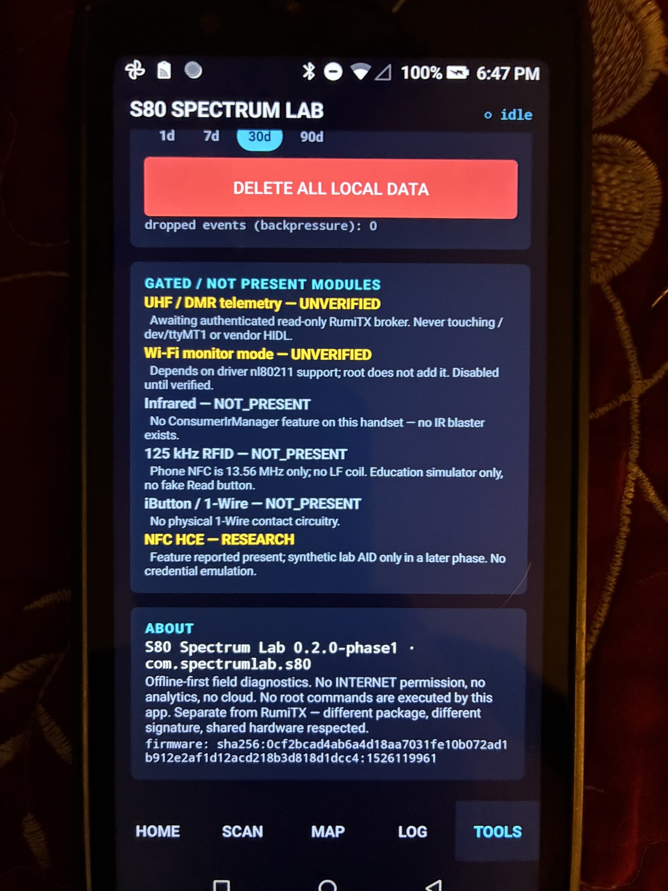
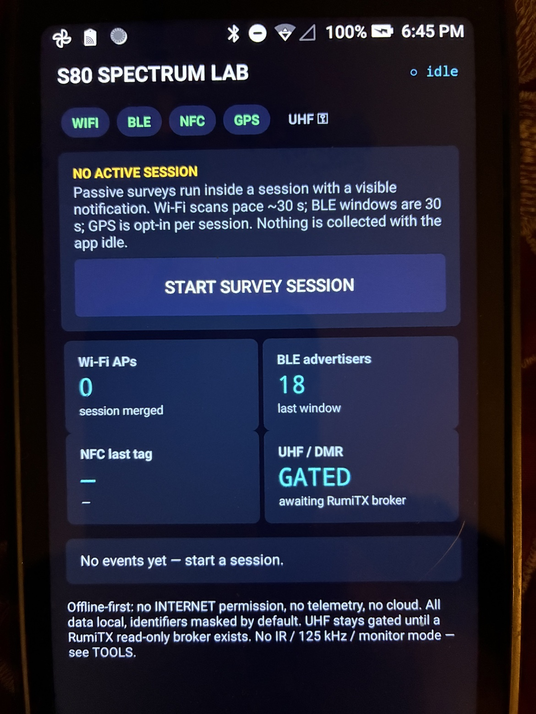
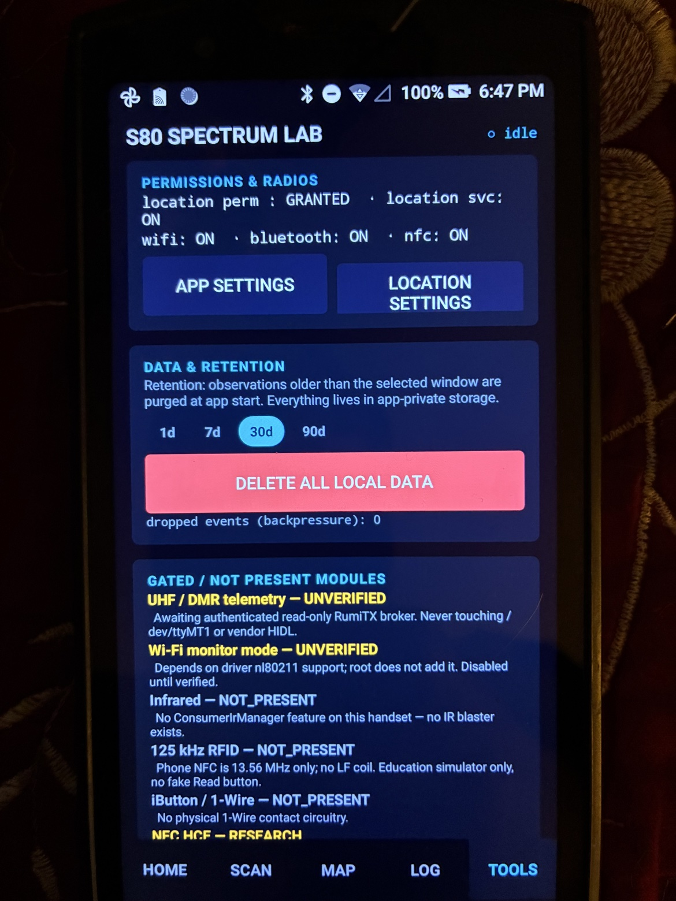
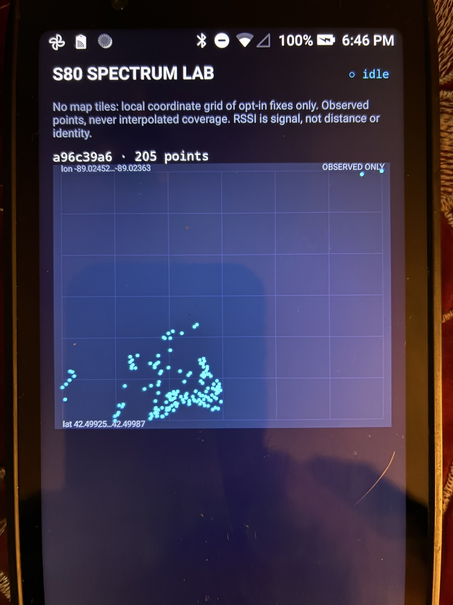

# S80 Spectrum Lab 2030

**Offline-first wireless diagnostics for the rooted DOOGEE S80.** Wi-Fi survey, BLE scanning, NFC reader, GPS tagging — Flipper Zero-inspired, no Flipper hardware required.


## What is this?

S80 Spectrum Lab turns your DOOGEE S80 into a handheld wireless survey tool. Think Flipper Zero's *spirit* — multi-radio diagnostics in your pocket — but built specifically for the S80's hardware, with zero cloud dependencies and zero data leaving your device.

**Phase 1 (shipped):**
- 📶 **Wi-Fi Survey** — 2.4/5 GHz access point discovery with channel, RSSI, security
- 📡 **BLE Scanner** — Bluetooth Low Energy advertisement capture with manufacturer ID decoding
- 📲 **NFC Reader** — Tag detection and NDEF parsing
- 📍 **GPS Tagging** — Opt-in location stamping on every observation
- 💾 **Local Storage** — SQLite event store with JSONL/CSV export
- 🔒 **Privacy-first** — MAC addresses pseudonymized, no INTERNET permission, no telemetry

**Phase 2 (in progress):**
- Signal history and channel occupancy charts
- Offline GPS survey grids with RSSI heatmaps
- Wi-Fi configuration drift alerts
- Reproducible reports with SHA-256 manifests

## Screenshots

Real screenshots from the DOOGEE S80:

| Home | Scan - Wi-Fi | Scan - BLE |
|------|--------------|------------|
|  |  |  |

| Scan - NFC | Scan - UHF (Gated) | Map |
|------------|-------------------|-----|
|  |  |  |

| Log | Tools - Capabilities | Tools - Details |
|-----|---------------------|-----------------|
|  |  |  |

## Requirements

- **DOOGEE S80** (rooted)
- **Android 8.1** (API 27) or higher
- No Google Play Services required
- No internet connection required (or allowed — the app requests zero network permissions)

## Building

```bash
# Requires JDK 17, Android SDK (API 27), Gradle 8.7
./gradlew assembleDebug
```

The APK will be at `app/build/outputs/apk/debug/`.

Or grab the pre-built APK from [Releases](../../releases).

## Installing

1. Download the latest APK from Releases
2. Enable "Install unknown apps" on your S80
3. Install and grant location permission when prompted (needed for Wi-Fi/BLE scanning on Android 8.1+)

## Privacy

This app is designed for **your eyes only**:
- No INTERNET permission — it *cannot* phone home
- MAC addresses are HMAC-pseudonymized before storage
- GPS is opt-in per session, never silent
- All data stays in app-private SQLite
- Exports are yours to share or delete

## Project Status

| Phase | Status |
|-------|--------|
| Phase 1: Wi-Fi/BLE/NFC/GPS survey | ✅ Shipped & verified on-device |
| Phase 2: Analysis and mapping | 🔨 In progress |
| Phase 3: Root diagnostics (bounded) | 📋 Planned |
| Phase 4: UHF/DMR integration | 📋 Planned (conditional) |

See [TEST_REPORT.md](TEST_REPORT.md) for full on-device verification details.

## Coexistence with RumiTX

S80 Spectrum Lab is designed to run alongside [RumiTX](https://github.com/Doug815/RumiTX) without conflicts. It never touches `/dev/ttyMT1`, `/dev/hctintercom_node`, or the RumiTX app process.

## License

MIT — see [LICENSE](LICENSE) for details.

## Built with

- Native Android (Kotlin/Java), zero dependencies
- Target SDK 27, Min SDK 26
- Dark electric-blue 2030 UI

---

*Part of the 2030 field toolkit. Built on-device, tested on-device, for the field.*
